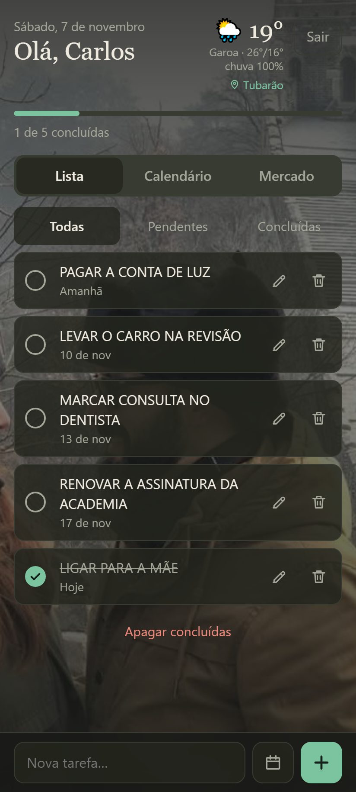
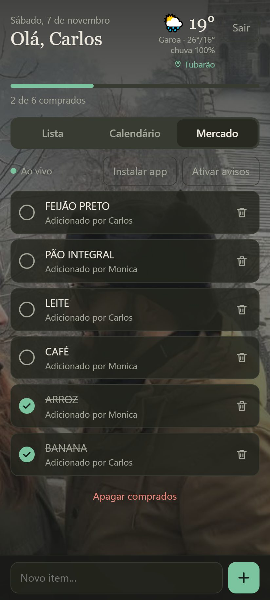
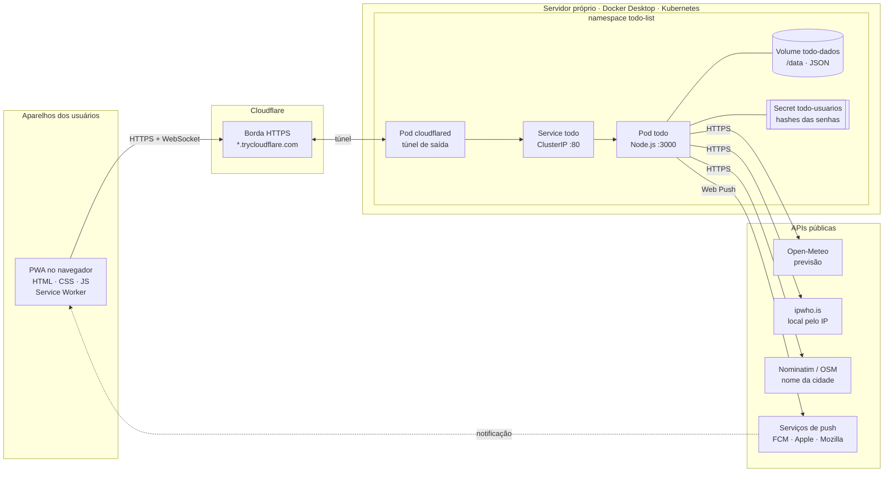
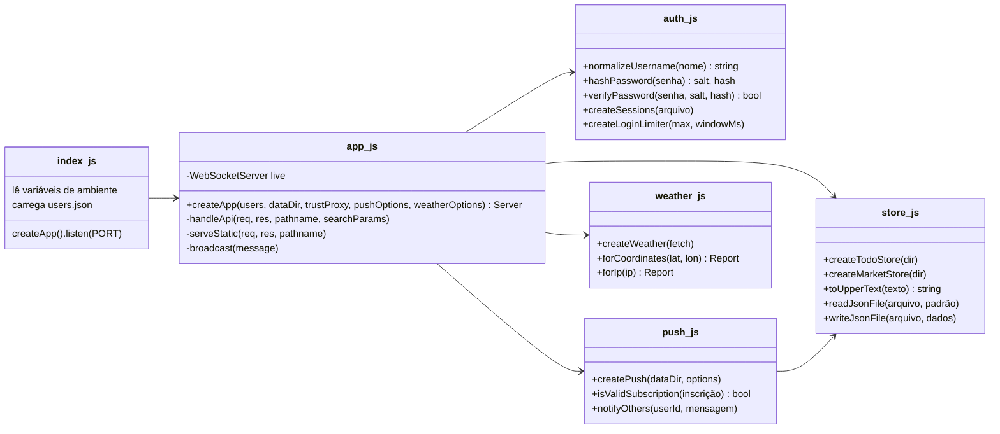
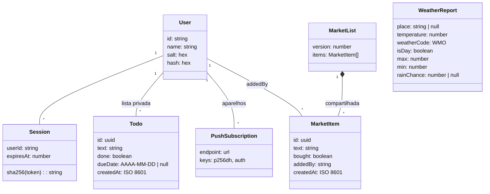
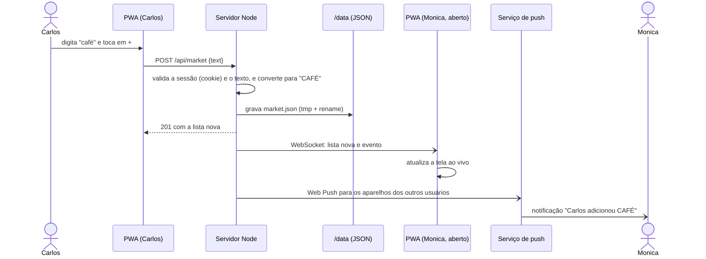
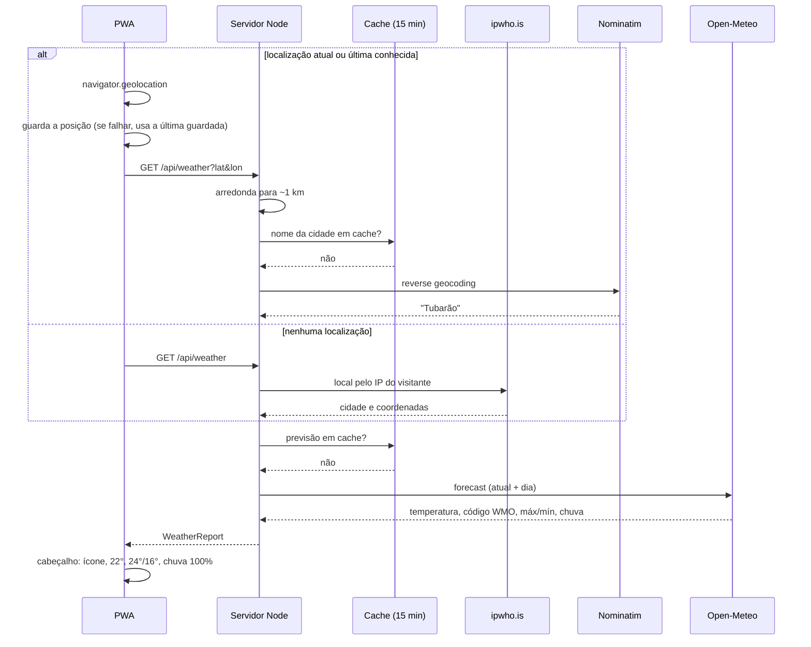

# Minhas Tarefas

App web de tarefas com login, calendário, lista de mercado compartilhada em tempo real e previsão do tempo. É um PWA: pode ser instalado no celular como um app e recebe notificações mesmo fechado.

> [!IMPORTANT]
> **Em produção, num servidor próprio, e em uso no dia a dia.**
> O app roda em um cluster Kubernetes hospedado no meu próprio computador, sem nuvem paga, e fica acessível pela internet por um túnel HTTPS da Cloudflare. É usado todos os dias, pelo celular, para organizar as tarefas e montar a lista de mercado compartilhada.

<table align="center">
  <tr>
    <td align="center"></td>
    <td align="center"></td>
    <td align="center"></td>
  </tr>
  <tr>
    <td align="center"><em>Lista</em></td>
    <td align="center"><em>Mercado ao vivo</em></td>
    <td align="center"><em>Calendário</em></td>
  </tr>
</table>

<p align="center"><em>Prints do app em tela de celular (412 px), com dados de exemplo. A previsão do tempo é real, pela localização do aparelho.</em></p>

## Funcionalidades

| Área | O que faz |
|---|---|
| **Lista** | Tarefas privadas por usuário: criar, editar, concluir, apagar, dar uma data e filtrar por todas, pendentes ou concluídas. O texto fica sempre em MAIÚSCULAS. |
| **Calendário** | Visão do mês com marcadores nos dias que têm tarefas. Ao tocar num dia, aparecem as tarefas dele e dá para criar outras já com essa data. |
| **Mercado** | Lista compartilhada entre os usuários e atualizada **em tempo real** via WebSocket. Quando alguém adiciona um item, os outros recebem uma **notificação push** no celular. Os itens ficam sempre em MAIÚSCULAS. |
| **Previsão do tempo** | O cabeçalho, ao lado da saudação, mostra a temperatura atual, a condição, a máxima e a mínima do dia, a chance de chuva e a cidade. O local vem da localização atual do aparelho; se ela falhar, da última localização que o aparelho informou; sem nenhuma, do IP. Atualiza a cada 30 minutos. |
| **PWA** | Instalável no Android e no iPhone, abre sem internet com o shell em cache (inclusive a foto de fundo) e funciona em tela cheia. |
| **Visual** | Tema escuro fixo em todos os aparelhos, com uma foto de fundo escurecida (mais no topo, para o cabeçalho continuar legível) e cartões semitransparentes. |

## Stack

| Camada | Tecnologia |
|---|---|
| Linguagem | **JavaScript** (Node.js no servidor e JavaScript puro no navegador) |
| Servidor | **Node.js 24**, só com o módulo `http` nativo, sem framework |
| Tempo real | **WebSocket** ([`ws`](https://github.com/websockets/ws)) |
| Notificações | **Web Push** com VAPID ([`web-push`](https://github.com/web-push-libs/web-push)) |
| Frontend | HTML, CSS e JavaScript puros, sem framework e sem etapa de build |
| PWA | Web App Manifest e Service Worker |
| Dados | Arquivos JSON num volume persistente, com escrita atômica (arquivo temporário seguido de `rename`) |
| Autenticação | Senhas com **scrypt**, sessão em cookie `HttpOnly` / `SameSite=Strict` e limite de tentativas de login |
| Testes | **`node:test`**, o executor de testes nativo do Node |
| Contêiner | **Docker** (`node:24-alpine`), rodando como usuário sem privilégios |
| Orquestração | **Kubernetes** (Docker Desktop) |
| Exposição pública | **Cloudflare Tunnel** (`cloudflared`), com HTTPS e sem abrir portas no roteador |

São só duas dependências de produção: `ws` e `web-push`.

## Arquitetura

O navegador fala só com o servidor do app, pela mesma origem. As APIs externas são chamadas pelo servidor. Por isso a política de segurança da página continua fechada em `'self'` e o IP de quem usa o app não é enviado do navegador para terceiros.



**Decisões de projeto**

- **Uma réplica só, com estratégia `Recreate`.** Os dados ficam em arquivos e as conexões em tempo real ficam em memória. A versão antiga para antes de a nova abrir o volume.
- **Nenhuma porta aberta para a internet.** O `cloudflared` abre uma conexão *de saída* para a Cloudflare, e o Service do app é `ClusterIP`, acessível só dentro do cluster.
- **As senhas não entram na imagem nem no Git.** Elas ficam num Secret do Kubernetes, montado como arquivo somente leitura.
- **Pods endurecidos:** rodam sem root, com sistema de arquivos somente leitura, `drop: [ALL]` nas capabilities, `seccomp RuntimeDefault` e sem token da service account.

## UML

### Componentes do servidor



### Modelo de dados



### Sequência: item novo no mercado



### Sequência: previsão do tempo no cabeçalho



## API

Todas as rotas `/api/*` exigem login, exceto `login` e `logout`. As respostas são JSON com `Cache-Control: no-store`.

| Método | Rota | Descrição |
|---|---|---|
| `POST` | `/api/login` | Entra com `{username, password}` e define o cookie de sessão |
| `POST` | `/api/logout` | Encerra a sessão e as conexões em tempo real dela |
| `GET` | `/api/me` | Usuário logado |
| `GET` | `/api/todos` | Tarefas do usuário |
| `POST` | `/api/todos` | Cria uma tarefa `{text, dueDate?}` |
| `PATCH` | `/api/todos/:id` | Altera `text`, `dueDate` e/ou `done` |
| `DELETE` | `/api/todos/:id` | Apaga uma tarefa |
| `POST` | `/api/todos/clear-done` | Apaga as concluídas |
| `GET` | `/api/market` | Lista de mercado |
| `POST` | `/api/market` | Adiciona um item `{text}` e notifica os outros usuários |
| `PATCH` | `/api/market/:id` | Marca como comprado `{bought}` |
| `DELETE` | `/api/market/:id` | Remove um item |
| `POST` | `/api/market/clear-bought` | Apaga os comprados |
| `WS` | `/api/market/live` | Lista de mercado em tempo real (exige mesma origem e sessão) |
| `GET` | `/api/push/key` | Chave pública VAPID |
| `POST` | `/api/push/subscribe` | Registra o aparelho para notificações |
| `POST` | `/api/push/unsubscribe` | Cancela a inscrição do aparelho |
| `GET` | `/api/weather?lat=&lon=` | Previsão do tempo (sem `lat`/`lon`, usa o local pelo IP) |
| `GET` | `/healthz` | Verificação de saúde, usada pelas probes do Kubernetes |

### APIs externas

| API | Uso | Chave |
|---|---|---|
| [Open-Meteo](https://open-meteo.com) | Previsão: temperatura atual, código do tempo (WMO), máxima, mínima e chance de chuva | Não precisa |
| [ipwho.is](https://ipwho.is) | Cidade e coordenadas aproximadas pelo IP do visitante | Não precisa |
| [Nominatim / OpenStreetMap](https://nominatim.org) | Nome da cidade a partir das coordenadas do GPS | Não precisa |
| Web Push (FCM, Apple, Mozilla, Windows) | Entrega das notificações; só esses serviços são aceitos | VAPID, gerada pelo app |

As coordenadas são arredondadas para cerca de 1 km e as respostas ficam 15 minutos em cache na memória. Se uma API cair, só a previsão some; o resto do app continua funcionando.

## Segurança

- Senhas guardadas só como hash **scrypt** com salt. A comparação usa `timingSafeEqual`, e um usuário inexistente leva o mesmo tempo para responder que uma senha errada.
- No disco fica só o **hash SHA-256** do token de sessão: quem ler o arquivo de sessões não consegue se passar por ninguém.
- **Limite de tentativas de login** por visitante (5 em 15 min) e por conta (20 por hora, mesmo trocando de IP).
- Cabeçalhos `Content-Security-Policy: default-src 'self'`, `X-Content-Type-Options` e `Referrer-Policy`. Os arquivos estáticos são servidos a partir de uma lista fixa, então nenhum caminho vindo da URL chega ao disco.
- O WebSocket confere a origem e a sessão. As inscrições de push só aceitam serviços conhecidos, para impedir SSRF.
- Toda operação usa o `userId` da sessão, nunca o enviado pelo cliente.
- A foto de fundo (`/bg.jpg`) é pública, como os demais arquivos do PWA: aparece na tela de login e abre sem login para quem tiver o endereço.
- A última posição do aparelho fica só no `localStorage` dele, arredondada para cerca de 10 m; o servidor arredonda de novo para cerca de 1 km antes de consultar as APIs.

## Testes realizados

**49 testes automatizados, todos passando** (`npm test`, com `node:test`). Eles sobem o servidor de verdade numa porta aleatória, com dados num diretório temporário. O push e as APIs de clima são simulados, então os testes não dependem da internet.

```
ℹ tests 49
ℹ pass 49
ℹ fail 0
```

| Grupo | O que é verificado |
|---|---|
| **Login e sessão** | Recusa senha errada e usuário inexistente; a senha de um usuário não entra na conta do outro; aceita maiúsculas e acentos no nome; cookie `HttpOnly`, `SameSite=Strict` e `Secure` com HTTPS; logout invalida a sessão; sessões sobrevivem a reiniciar o servidor sem guardar o token |
| **Limite de tentativas** | Muitas senhas erradas bloqueiam até a senha certa; atrás do túnel, o limite vale por visitante; trocar de IP não escapa do limite por conta; sem túnel, o cabeçalho de IP é ignorado |
| **Tarefas** | Criar, editar, concluir e apagar; o texto é gravado em maiúsculas ao criar e ao editar; reagendar e tirar a data; concluir não apaga a data; texto e data inválidos são recusados |
| **Privacidade** | Cada usuário vê só a própria lista; não altera nem apaga tarefa do outro pelo id; o cliente não escolhe de quem é a lista; apagar concluídas só afeta a própria lista |
| **Mercado e tempo real** | Itens em maiúsculas, inclusive com acentos; lista igual para todos; um usuário marca e apaga item do outro; item novo chega ao vivo; quem conecta depois recebe a lista atual; o WebSocket exige login e mesma origem; logout encerra a conexão |
| **Notificações** | Vão só para os outros usuários; marcar como comprado não notifica; o aparelho passa para quem entrou por último; o usuário só cancela a própria inscrição; inscrição cancelada pelo navegador é removida; falha no push não impede adicionar o item; só serviços de push conhecidos são aceitos; a chave VAPID persiste |
| **Previsão do tempo** | Exige login; o GPS traz a cidade e arredonda as coordenadas; sem GPS usa o IP, e um IP interno cai no IP público; o cache evita chamadas repetidas; coordenadas inválidas são recusadas; API fora do ar vira 502 sem derrubar o app |
| **Servidor** | Arquivos do PWA e `/healthz` são públicos; arquivos do servidor e dados nunca são servidos; a página inicial sai com os cabeçalhos de segurança |

**Validação em produção**

- Depois de cada publicação, o endereço público foi testado: `/`, `/healthz`, `/manifest.webmanifest` e `/sw.js` responderam 200, e `/api/weather` respondeu 401 sem login.
- O módulo de clima foi testado de dentro do pod, com as APIs reais, pelo IP e pelo GPS.
- O app foi testado no celular Android: login e lista de mercado ao vivo.
- Os prints do início foram gerados com o app rodando localmente, dados de exemplo e o Edge em modo headless emulando um celular, com a localização de Tubarão (SC) e as APIs de clima reais.
- O cabeçalho com a previsão e a foto de fundo foi conferido renderizado nas larguras de celular de 360 px e 412 px.

## Estrutura do projeto

```
├── server/
│   ├── index.js        # ponto de entrada: configuração e listen
│   ├── app.js          # rotas HTTP, WebSocket e cabeçalhos de segurança
│   ├── auth.js         # senhas (scrypt), sessões e limite de login
│   ├── store.js        # tarefas e mercado em arquivos JSON
│   ├── push.js         # notificações Web Push (VAPID)
│   └── weather.js      # previsão do tempo (Open-Meteo, ipwho.is, Nominatim)
├── public/
│   ├── index.html      # interface (login, lista, calendário, mercado, previsão)
│   ├── app.js          # lógica do cliente
│   ├── style.css       # tema escuro, foto de fundo e layout responsivo
│   ├── sw.js           # service worker: cache do shell e push
│   ├── manifest.webmanifest
│   ├── bg.jpg          # foto de fundo
│   └── icons/
├── test/app.test.js    # 49 testes de integração
├── k8s/                # namespace, PVC, Deployments, Service e túnel
├── scripts/
│   ├── deploy.ps1      # build da imagem e publicação no Kubernetes
│   └── set-password.js # cria usuário ou troca senha
├── docs/screenshots/
└── Dockerfile
```

## Publicar no Kubernetes

Precisa do Docker Desktop com o Kubernetes ligado. Na pasta do projeto, em PowerShell:

```
.\scripts\deploy.ps1
```

O script roda cinco etapas:

1. Constrói a imagem com uma tag nova (`to-do-list:<versão>-<data-hora>`).
2. Cria ou atualiza o Secret com as senhas.
3. Aplica os manifests.
4. Espera o rollout e mostra o endereço público.
5. Apaga as imagens antigas do app, guardando só a atual e a anterior.

Para voltar à versão anterior: `kubectl -n todo-list rollout undo deployment/todo`.

Use o mesmo comando para publicar atualizações. Publicar de novo não troca o endereço.

Os pods do Kubernetes não aparecem na lista de containers do Docker Desktop. Para vê-los:

```
kubectl -n todo-list get pods
kubectl -n todo-list logs deployment/todo
```

### Descobrir o endereço público

O túnel rápido da Cloudflare não precisa de conta, mas **o endereço muda sempre que o pod `cloudflared` reinicia**, o que inclui reiniciar o computador ou o Docker Desktop. Para ver o endereço atual:

```
kubectl -n todo-list logs deployment/cloudflared | Select-String trycloudflare
```

Quando o endereço muda, o app instalado no celular para de funcionar. É preciso abrir o endereço novo, instalar de novo, entrar e ativar os avisos outra vez. Um endereço fixo exige uma conta na Cloudflare e um domínio próprio, com um túnel nomeado no lugar do túnel rápido em [k8s/todo-list.yaml](k8s/todo-list.yaml).

### Disponibilidade

- O app continua no ar com o editor e o terminal fechados. Ele só para quando o computador ou o Docker Desktop é desligado.
- Com a opção "Start Docker Desktop when you sign in" ligada, o app volta sozinho depois de reiniciar o computador, mas com um endereço novo.

## Instalar no celular

- **Android (Chrome):** abra o endereço e use o botão **Instalar app** na aba Mercado, ou o menu do navegador.
- **iPhone (Safari):** toque em Compartilhar e em **Adicionar à Tela de Início**. No iPhone, as notificações só funcionam com o app instalado e com iOS 16.4 ou mais novo.

Depois, na aba Mercado, toque em **Ativar avisos**. Cada usuário precisa fazer isso no próprio aparelho. A primeira ativação pode levar cerca de 30 segundos.

A previsão pede acesso à localização ao abrir o app; permita para ela seguir o aparelho. Tocar no nome da cidade atualiza na hora.

## Usuários e senhas

As senhas ficam em `server/users.json`, apenas como hash. Esse arquivo não vai para o Git nem para a imagem; no Kubernetes ele fica em um Secret. Depois de clonar o repositório, crie os usuários antes de rodar o app. Para criar um usuário ou trocar uma senha:

```
node scripts/set-password.js <nome> <nova-senha>
.\scripts\deploy.ps1
```

Com o app na internet, prefira senhas longas: o limite de tentativas atrasa quem tenta adivinhar uma senha de 4 dígitos, mas não impede.

## Dados e backup

No Kubernetes, tudo fica no volume `todo-dados`, montado em `/data`: um arquivo de tarefas por usuário, a lista de mercado, as sessões e as chaves de notificação.

O volume é apagado junto com o namespace, e também se o Kubernetes do Docker Desktop for reiniciado de fábrica. Para copiar os dados para o computador:

```
$pod = kubectl -n todo-list get pod -l app=todo -o name
kubectl -n todo-list cp "$($pod.Split('/')[1]):/data" backup
```

## Rodar sem Kubernetes

Precisa do Node.js 20 ou mais novo.

```
npm install
npm start
```

Neste modo os dados ficam na pasta `data/`, separados dos dados do Kubernetes. Notificações e instalação como app só funcionam em `localhost` ou com HTTPS.

## Testes

```
npm test
```
