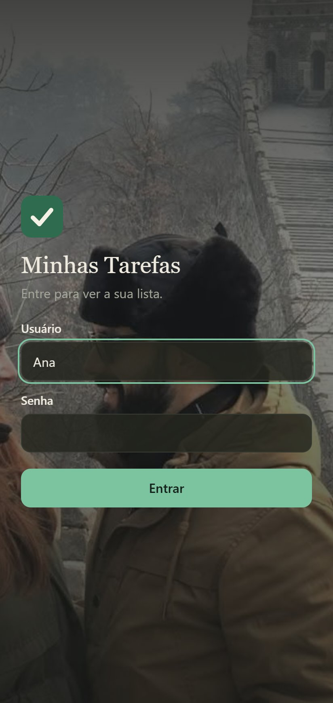
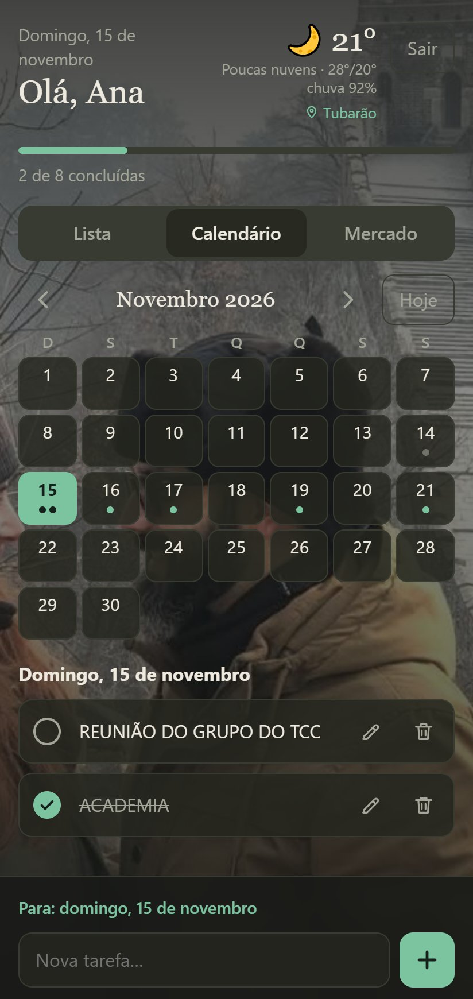
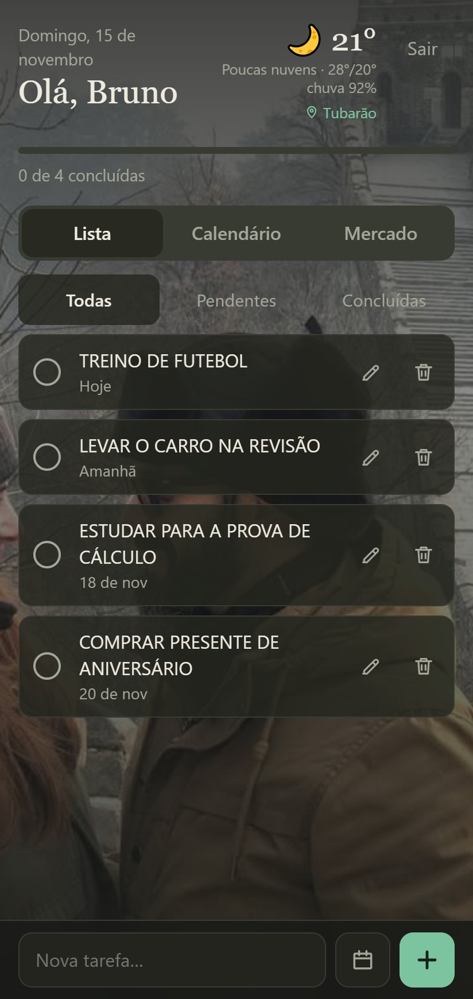
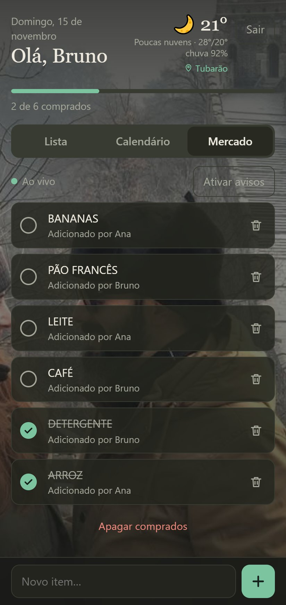
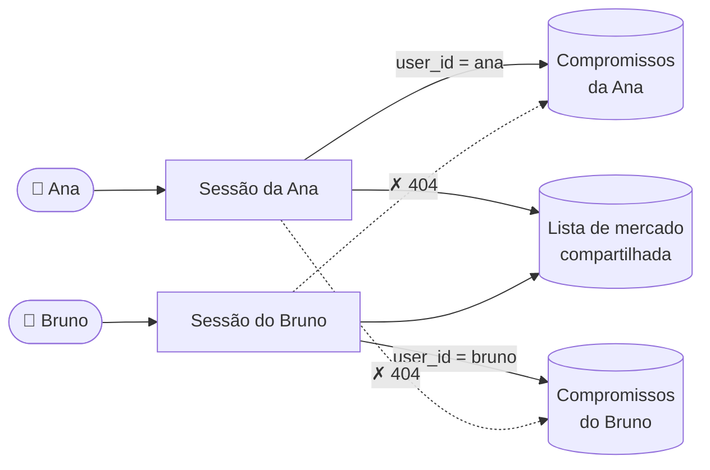
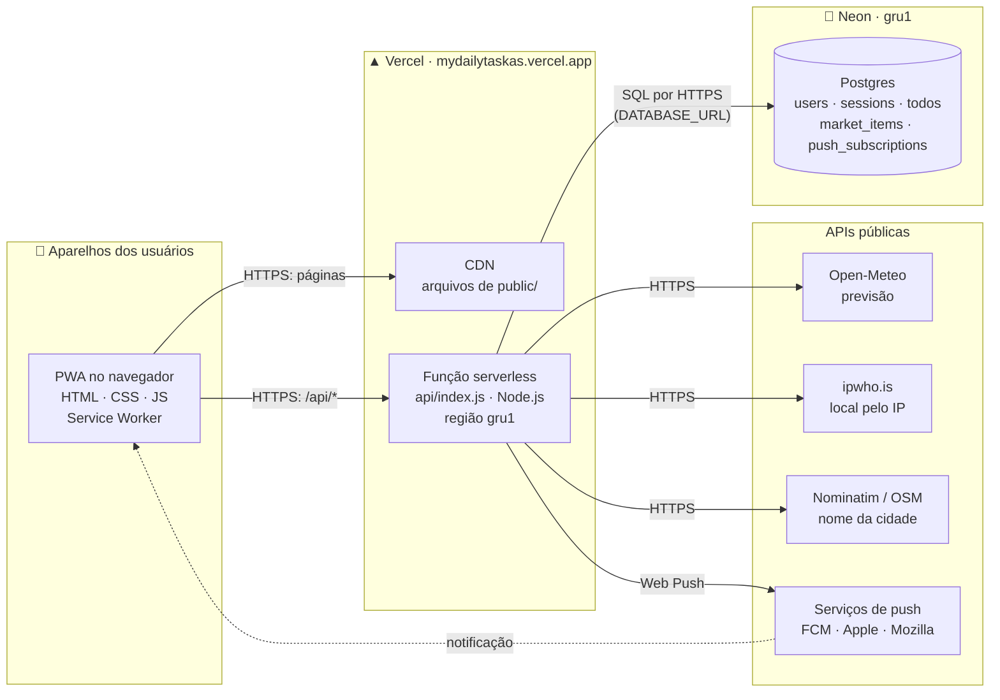
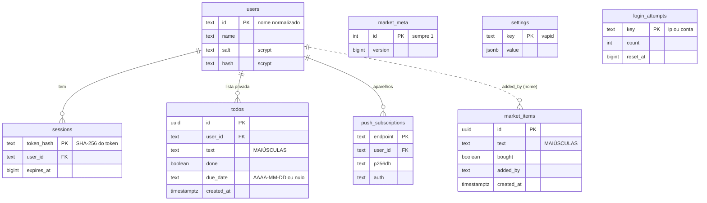
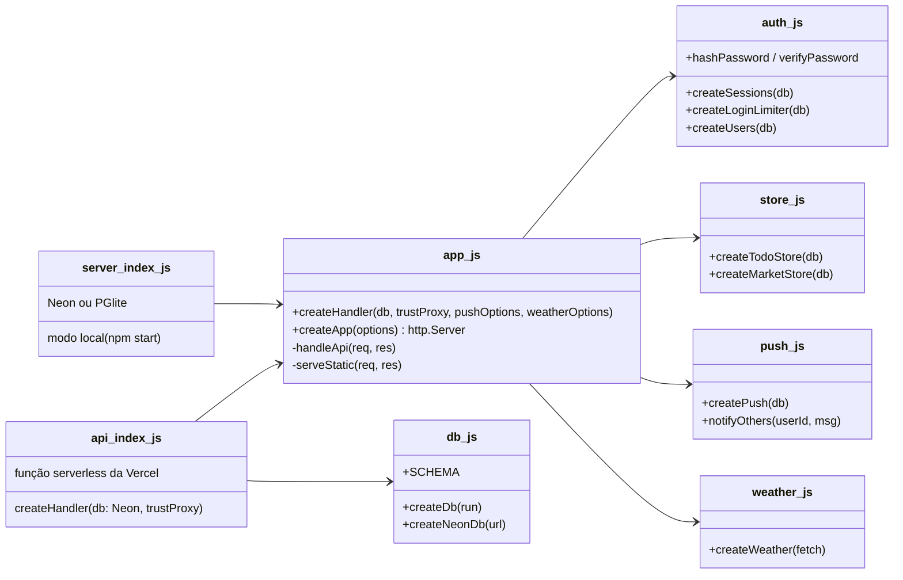
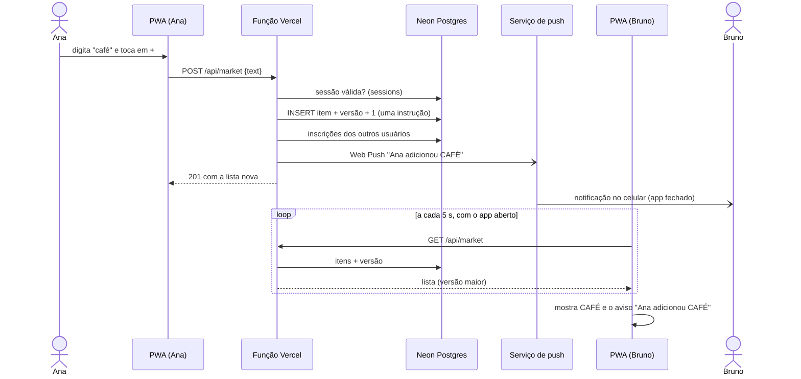
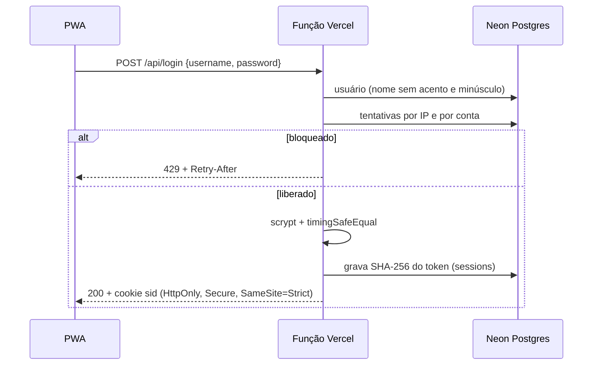

# Daily Tasks · Minhas Tarefas

App web (PWA) de compromissos com calendário, **lista de compromissos privada para cada usuário** e **lista de mercado compartilhada** entre todos, com notificações no celular e previsão do tempo.

> [!IMPORTANT]
> **🟢 Em produção e em uso no dia a dia.**
>
> - 🌐 **No ar:** [mydailytaskas.vercel.app](https://mydailytaskas.vercel.app) (acesso restrito aos usuários cadastrados)
>
> Hospedado na **Vercel** (função serverless em São Paulo, `gru1`) com banco **Neon Postgres** (também em São Paulo), nos planos gratuitos. É usado todos os dias, pelo celular, para organizar os compromissos de cada um e montar juntos a lista de mercado da casa.


<table align="center">
  <tr>
    <td align="center"></td>
    <td align="center"></td>
    <td align="center"></td>
    <td align="center"></td>
  </tr>
  <tr>
    <td align="center"><em>Login</em></td>
    <td align="center"><em>Lista</em></td>
    <td align="center"><em>Calendário</em></td>
    <td align="center"><em>Mercado</em></td>
  </tr>
</table>

<p align="center"><em>Prints em tela de celular (412 px) com <strong>usuários e dados fictícios</strong> (Ana e Bruno). A previsão do tempo é real.</em></p>

## Permissões dos usuários

Cada pessoa entra com o próprio usuário e senha. O app separa os dados em duas partes:

| Dado | Quem vê | Quem altera |
|---|---|---|
| **Compromissos** (lista e calendário) | Só o dono | Só o dono |
| **Lista de mercado** | Todos os usuários | Todos os usuários: qualquer um adiciona, marca como comprado ou apaga |
| **Aparelhos para notificação** | Só o dono | Só o dono |

Na prática, é o mesmo app para a casa toda: **cada um tem a sua agenda de compromissos** e **todos montam a mesma lista de compras**. Quando alguém adiciona um item, os outros recebem uma notificação no celular.

<table align="center">
  <tr>
    <td align="center"></td>
    <td align="center"></td>
    <td align="center"></td>
    <td align="center"></td>
  </tr>
  <tr>
    <td align="center"><em>Compromissos da Ana</em></td>
    <td align="center"><em>Compromissos do Bruno</em></td>
    <td align="center"><em>Mercado visto pela Ana</em></td>
    <td align="center"><em>Mercado visto pelo Bruno</em></td>
  </tr>
</table>

<p align="center"><em>Agendas diferentes, mesma lista de mercado: os itens mostram quem adicionou cada um.</em></p>

**Como a separação é garantida no servidor:**

- O usuário de cada pedido sai sempre da **sessão** (cookie `HttpOnly`), nunca de algo enviado pelo navegador.
- Toda consulta de compromissos no banco filtra por `user_id`: `WHERE id = $1 AND user_id = $2`. O id de um compromisso de outra pessoa simplesmente não encontra nada (404).
- A lista de mercado não tem dono; a resposta dela nunca inclui compromissos.
- Esses pontos são cobertos por testes automatizados (veja [Testes realizados](#testes-realizados)).



## Funcionalidades

| Área | O que faz |
|---|---|
| **Lista** | Compromissos privados por usuário: criar, editar, concluir, apagar, dar uma data e filtrar por todos, pendentes ou concluídos. O texto fica sempre em MAIÚSCULAS. |
| **Calendário** | Visão do mês com marcadores nos dias que têm compromissos. Ao tocar num dia, aparecem os compromissos dele e dá para criar outros já com essa data. |
| **Mercado** | Lista **compartilhada** entre os usuários, atualizada sozinha a cada 5 segundos com o app aberto. Mostra quem adicionou cada item e avisa quando outra pessoa adiciona algo. Com o app fechado, chega uma **notificação push** no celular. |
| **Previsão do tempo** | No cabeçalho: temperatura atual, condição, máxima e mínima, chance de chuva e cidade, pela localização do aparelho (ou pelo IP, sem GPS). |
| **PWA** | Instalável no Android e no iPhone, abre sem internet com o shell em cache e funciona em tela cheia. |
| **Visual** | Tema escuro fixo, foto de fundo escurecida e cartões semitransparentes. |

## Stack

| Camada | Tecnologia |
|---|---|
| Linguagem | **JavaScript** (Node.js no servidor e JavaScript puro no navegador) |
| Hospedagem | **Vercel** (plano Hobby, gratuito): arquivos estáticos na CDN e API como **função serverless** Node.js em `gru1` (São Paulo) |
| Banco de dados | **Neon Postgres** (plano Free, gratuito), região `gru1`, acessado pelo driver HTTP [`@neondatabase/serverless`](https://github.com/neondatabase/serverless) |
| Servidor | Node.js com o módulo `http` nativo, sem framework |
| Notificações | **Web Push** com VAPID ([`web-push`](https://github.com/web-push-libs/web-push)) |
| Frontend | HTML, CSS e JavaScript puros, sem framework e sem etapa de build |
| PWA | Web App Manifest e Service Worker |
| Autenticação | Senhas com **scrypt**, sessão em cookie `HttpOnly` / `SameSite=Strict` / `Secure` e limite de tentativas de login |
| Testes | **`node:test`** com **PGlite** (Postgres em memória), sem depender da internet |

São só duas dependências de produção: `@neondatabase/serverless` e `web-push`.

## Arquitetura



O navegador fala só com a própria origem. As APIs externas são chamadas pela função, então a política de segurança da página continua fechada em `'self'`.

**Decisões de projeto**

- **Função e banco na mesma região (São Paulo).** Cada pedido faz algumas consultas ao Neon; com os dois em `gru1`, cada uma leva poucos milissegundos.
- **Driver HTTP do Neon.** Funções serverless nascem e morrem o tempo todo; o driver HTTP não mantém conexões abertas, então não esgota o limite de conexões do Postgres.
- **Mercado por consulta periódica, não WebSocket.** A Vercel não mantém conexões abertas por muito tempo. Com o app na tela, o cliente consulta `/api/market` a cada 5 s; a versão da lista, que cresce a cada mudança, evita redesenhar à toa. Com o app fechado, quem avisa é a notificação push.
- **Tudo que era memória foi para o banco.** Sessões, limite de tentativas de login e chaves VAPID ficam no Postgres, porque cada pedido pode cair numa instância diferente da função.
- **Esquema criado automaticamente.** Na primeira consulta de cada instância, o app roda `CREATE TABLE IF NOT EXISTS` ([server/db.js](server/db.js)); não há etapa de migração manual.
- **Notificação antes da resposta.** Numa função serverless, o que roda depois da resposta pode ser congelado, então o push é enviado antes de responder.
- **Custo zero.** Vercel Hobby e Neon Free cobrem com folga o uso de uma casa.

## UML

### Modelo de dados



### Componentes do servidor



### Sequência: item novo no mercado



### Sequência: login



## API

Todas as rotas `/api/*` exigem login, exceto `login` e `logout`. As respostas são JSON com `Cache-Control: no-store`.

| Método | Rota | Descrição | Escopo |
|---|---|---|---|
| `POST` | `/api/login` | Entra com `{username, password}` e define o cookie de sessão | público |
| `POST` | `/api/logout` | Encerra a sessão | público |
| `GET` | `/api/me` | Usuário logado | próprio |
| `GET` | `/api/todos` | Compromissos do usuário | **privado** |
| `POST` | `/api/todos` | Cria `{text, dueDate?}` | **privado** |
| `PATCH` | `/api/todos/:id` | Altera `text`, `dueDate` e/ou `done` | **privado** |
| `DELETE` | `/api/todos/:id` | Apaga | **privado** |
| `POST` | `/api/todos/clear-done` | Apaga os concluídos | **privado** |
| `GET` | `/api/market` | Lista de mercado `{version, items}` | compartilhado |
| `POST` | `/api/market` | Adiciona `{text}` e notifica os outros | compartilhado |
| `PATCH` | `/api/market/:id` | Marca como comprado `{bought}` | compartilhado |
| `DELETE` | `/api/market/:id` | Remove um item | compartilhado |
| `POST` | `/api/market/clear-bought` | Apaga os comprados | compartilhado |
| `GET` | `/api/push/key` | Chave pública VAPID | — |
| `POST` | `/api/push/subscribe` | Registra o aparelho para notificações | próprio |
| `POST` | `/api/push/unsubscribe` | Cancela a inscrição do aparelho | próprio |
| `GET` | `/api/weather?lat=&lon=` | Previsão do tempo (sem `lat`/`lon`, pelo IP) | — |
| `GET` | `/healthz` | Verificação de saúde | público |

### APIs externas

| API | Uso | Chave |
|---|---|---|
| [Open-Meteo](https://open-meteo.com) | Previsão: temperatura, código WMO, máxima, mínima e chance de chuva | Não precisa |
| [ipwho.is](https://ipwho.is) | Cidade aproximada pelo IP | Não precisa |
| [Nominatim / OpenStreetMap](https://nominatim.org) | Nome da cidade a partir das coordenadas | Não precisa |
| Web Push (FCM, Apple, Mozilla, Windows) | Entrega das notificações | VAPID, gerada pelo app e guardada no banco |

## Segurança

- Senhas guardadas só como hash **scrypt** com salt; comparação com `timingSafeEqual`. Usuário inexistente leva o mesmo tempo que senha errada.
- No banco fica só o **SHA-256** do token de sessão: quem ler a tabela não consegue se passar por ninguém.
- **Limite de tentativas de login** por visitante (5 em 15 min) e por conta (20 por hora, mesmo trocando de IP), guardado no Postgres para valer em todas as instâncias da função. O IP vem do cabeçalho `x-real-ip`, que a Vercel sobrescreve.
- Cookie `HttpOnly`, `Secure` e `SameSite=Strict`.
- Cabeçalhos `Content-Security-Policy: default-src 'self'`, `X-Content-Type-Options` e `Referrer-Policy`, aplicados pela Vercel ([vercel.json](vercel.json)) e pela função.
- Toda consulta SQL é parametrizada (`$1`, `$2`…); ids que não são UUID são recusados antes de chegar ao banco.
- As inscrições de push só aceitam serviços conhecidos, para impedir SSRF.
- A conexão do banco (`DATABASE_URL`) fica só nas variáveis de ambiente da Vercel e no `.env.local`, que não vai para o Git.

## Testes realizados

### Automatizados: 49 testes, todos passando

`npm test`, com `node:test`. Cada execução sobe o servidor de verdade numa porta aleatória, com um **Postgres em memória (PGlite)** usando o mesmo esquema do Neon. Push e APIs de clima são simulados, então os testes não dependem da internet.

```
ℹ tests 49
ℹ pass 49
ℹ fail 0
```

| Grupo | O que é verificado |
|---|---|
| **Login e sessão** | Recusa senha errada e usuário inexistente; a senha de um usuário não entra na conta do outro; aceita maiúsculas e acentos no nome; cookie `HttpOnly`, `SameSite=Strict` e `Secure` com HTTPS; logout invalida a sessão; sessões ficam no banco, sobrevivem a reiniciar e não guardam o token; sessão vencida não dá acesso |
| **Limite de tentativas** | Senhas erradas bloqueiam até a senha certa; atrás do proxy da Vercel o limite é por visitante; trocar de IP não escapa do limite por conta; fora da Vercel o cabeçalho de IP é ignorado |
| **Permissões** | Cada usuário vê só a própria lista; não altera nem apaga compromisso do outro pelo id; o cliente não escolhe de quem é a lista; apagar concluídos só afeta a própria lista; a lista de mercado é a mesma para todos e não vaza compromissos |
| **Compromissos** | Criar, editar, concluir e apagar; texto em maiúsculas; reagendar e tirar a data; concluir não apaga a data; texto, data e id inválidos são recusados |
| **Mercado** | Itens em maiúsculas, inclusive acentos; um usuário marca e apaga item do outro; item novo aparece na próxima consulta do outro com versão maior; a versão só muda quando a lista muda |
| **Notificações** | Vão só para os outros usuários; marcar como comprado não notifica; o aparelho passa para quem entrou por último; o usuário só cancela a própria inscrição; inscrição cancelada pelo navegador é removida; falha no push não impede adicionar o item; só serviços de push conhecidos; a chave VAPID fica no banco entre reinícios |
| **Previsão do tempo** | Exige login; GPS traz a cidade e arredonda as coordenadas; sem GPS usa o IP; cache; coordenadas inválidas recusadas; API fora do ar vira 502 sem derrubar o app |
| **Servidor** | Arquivos do PWA e `/healthz` são públicos; código, configuração e dados nunca são servidos; cabeçalhos de segurança |

### Em produção (mydailytaskas.vercel.app)

Teste ponta a ponta contra a Vercel + Neon reais, com dois usuários temporários criados só para isso e apagados no fim (o banco voltou a 0 compromissos e 0 itens): **20 de 20 verificações OK**.

| Verificação | Resultado |
|---|---|
| `/healthz`, API sem login (401), senha errada (401) | ✅ |
| Login com cookie `HttpOnly` + `Secure` + `SameSite=Strict` | ✅ |
| Criar e concluir compromisso (texto em maiúsculas, data mantida) | ✅ |
| Usuário B **não vê, não altera e não apaga** compromisso do usuário A | ✅ |
| Item adicionado por A aparece para B, com versão maior; B marca como comprado | ✅ |
| Chave VAPID criada e estável entre pedidos | ✅ |
| Previsão do tempo pelo GPS e pelo IP (APIs reais) | ✅ |
| Logout invalida a sessão; limite de tentativas responde 429 | ✅ |
| Arquivos do servidor, `package.json` e `.env.local` respondem 404 | ✅ |

### No navegador

- Com o Edge em modo headless, dois usuários ao mesmo tempo: o item adicionado por um aparece sozinho para o outro em até 5 s, com o aviso "Bruno adicionou CAFÉ" e o contador na aba Mercado; o próprio item não gera aviso.
- Os prints deste README foram gerados assim, com o app rodando localmente, dados fictícios, tela de 412 px e a localização de Tubarão (SC) com as APIs de clima reais.

## Estrutura do projeto

```
├── api/
│   └── index.js        # função serverless da Vercel (todas as rotas /api/*)
├── server/
│   ├── app.js          # rotas HTTP e cabeçalhos de segurança (createHandler)
│   ├── db.js           # esquema do Postgres e conexão com o Neon
│   ├── pglite.js       # Postgres embutido para testes e modo local
│   ├── auth.js         # senhas (scrypt), sessões, limite de login e usuários
│   ├── store.js        # compromissos (privados) e mercado (compartilhado)
│   ├── push.js         # notificações Web Push (VAPID)
│   ├── weather.js      # previsão do tempo
│   └── index.js        # servidor local (npm start)
├── public/             # PWA: index.html, app.js, style.css, sw.js, ícones
├── scripts/
│   └── set-password.js # cria usuário ou troca senha no banco
├── test/app.test.js    # 49 testes de integração
├── docs/screenshots/   # prints com dados fictícios
└── vercel.json         # região, rotas e cabeçalhos
```

## Publicar na Vercel

O projeto `dailytasks` já está ligado à Vercel e ao Neon (integração da Vercel, que cria `DATABASE_URL` nos ambientes). Para publicar uma atualização:

```
npm test
vercel deploy --prod
```

O esquema do banco é criado ou conferido sozinho na primeira consulta; não há passo de migração.

Para montar do zero em outra conta (tudo gratuito):

1. `vercel link` para criar o projeto.
2. `vercel integration add neon --meta region=gru1` para criar o banco Neon e as variáveis de ambiente.
3. `vercel env pull .env.local` para trazer a `DATABASE_URL` para o computador.
4. Criar os usuários (abaixo) e `vercel deploy --prod`.

## Usuários e senhas

Não existe cadastro pelo app: os usuários são criados por quem administra, direto no banco. Para criar um usuário ou trocar uma senha em produção:

```
node --env-file=.env.local scripts/set-password.js <nome> <nova-senha>
```

O login não diferencia maiúsculas nem acentos ("Mônica" e "monica" são a mesma conta). Prefira senhas longas.

## Dados e backup

Tudo fica no Neon. O plano Free guarda o histórico do banco por um período e permite restaurar pelo painel. Para uma cópia local:

```
pg_dump "$DATABASE_URL" > backup.sql
```

## Rodar localmente

Precisa do Node.js 20 ou mais novo.

```
npm install
npm start
```

Sem `DATABASE_URL`, o app usa um **Postgres embutido (PGlite)** gravado em `data/pglite`, separado da produção. Crie um usuário local com `node scripts/set-password.js <nome> <senha>`. Para rodar local apontando para o Neon: `npm run start:neon`.

Notificações e instalação como app só funcionam em `localhost` ou com HTTPS.

## Instalar no celular

- **Android (Chrome):** abra [mydailytaskas.vercel.app](https://mydailytaskas.vercel.app) e use **Instalar app** na aba Mercado, ou o menu do navegador.
- **iPhone (Safari):** Compartilhar → **Adicionar à Tela de Início**. As notificações exigem o app instalado e iOS 16.4 ou mais novo.

Depois, na aba Mercado, toque em **Ativar avisos**. Cada usuário faz isso no próprio aparelho.
